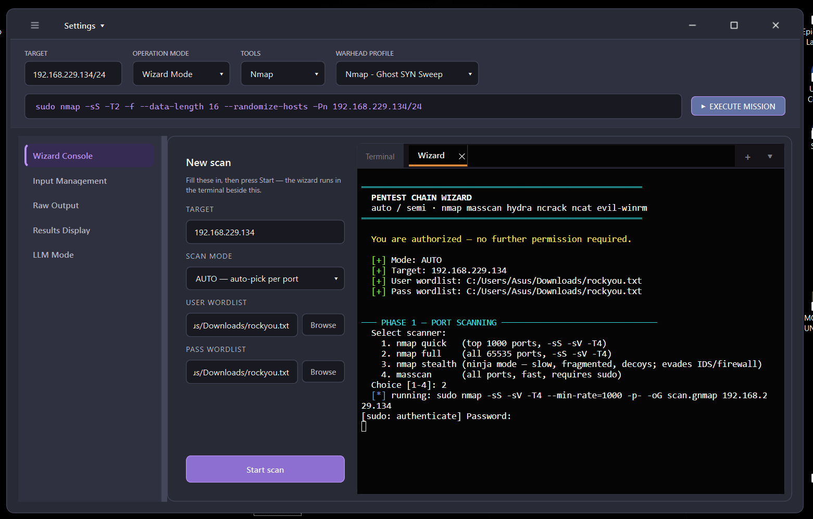
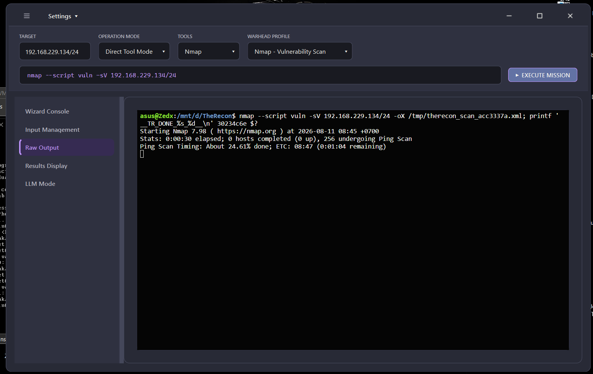
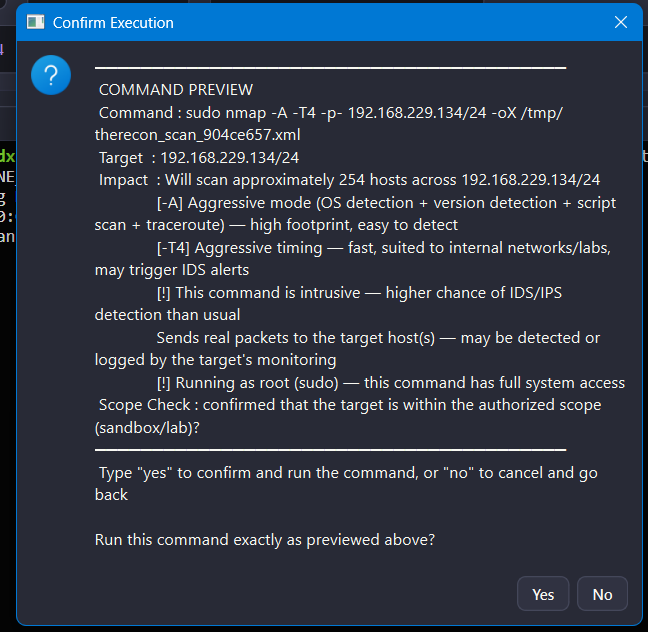
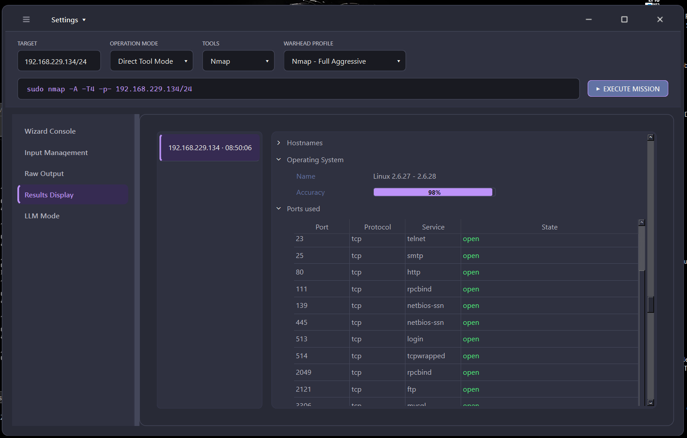
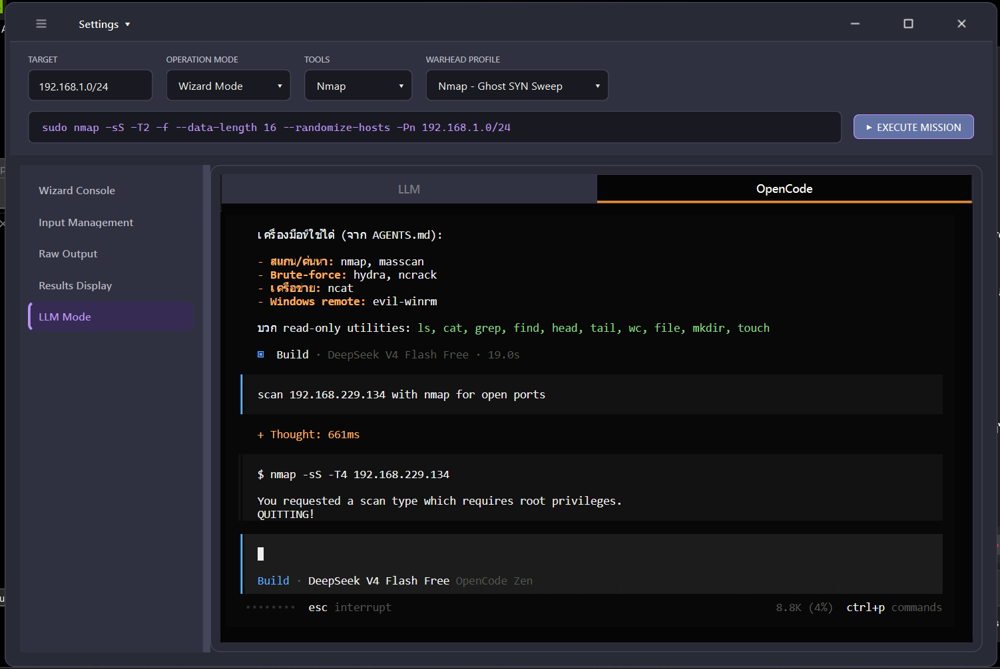
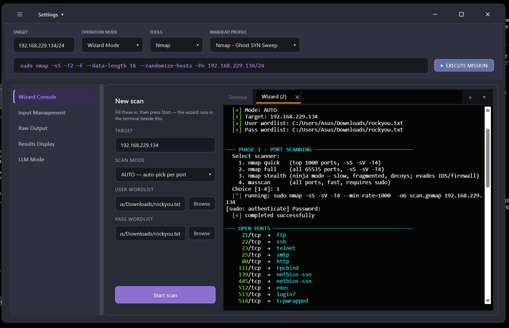

# PP-Reconnaissance-tools

> **Safety-gated GUI orchestrator for authorized network reconnaissance.**
> Solves the "one wrong flag away from scanning the wrong subnet" problem by forcing every command through validation → preview → exact-`yes` confirmation → audited execution, all behind a single desktop app.


---

## Screenshots

| Wizard Console (guided chain) | Direct Tool Mode (manual + validated) |
|---|---|
|  |  |

| Confirmation Gate (exact-`yes` required) | Parsed Results Display |
|---|---|
|  |  |

| LLM-assisted Mode (ungated by design) | Wizard Step 2 |
|---|---|
|  |  |

> Additional screenshots in [`img-gui/`](img-gui/): `input-management.png`, `setting.png`, `llm-nmap-mode.png`, `llm-agent2.png`.
> <!-- TODO: record a short GIF demo of the full Wizard chain (scan → plan → brute → post-exploit) and replace this line. -->

---

## What this app does

PP-Reconnaissance-tools is a desktop app that helps you run common network scans and tests. It wraps the tools in a guided wizard, a command preview, and an approval step, so you always see what will run before it runs.

**Use it only on systems you have permission to test**, such as your own lab machines.

## Features

- **Wizard** — enter a target, run a scan, pick steps from a ranked plan, and approve each step.
- **Direct Tool Mode** — choose or type a command, see the preview, then approve it.
- **Basic scan presets** — ready-made nmap scans (quick scan, common services, web ports, and more).
- **Results** — open ports, detected services, and any login found.
- **Wordlists** — use your own password lists. Save a file into the shared folder from Settings.
- **Logs** — view or clear the wizard's run logs from Settings.
- **AI helper (optional)** — suggests one nmap command for a goal. It never runs by itself.
- **OpenCode (optional)** — an AI agent that works inside the tool container.

## How it keeps things safe

- **Tools run in Docker, not on your computer.** The container is locked down: read-only, limited permissions, and it only sees the results folder and the wordlists folder.
- **Only 6 tools are allowed:** nmap, masscan, hydra, ncrack, ncat and evil-winrm. Anything else is refused.
- **Shell tricks are blocked.** Characters like `;`, `&&`, `|` and `$( )` in targets or commands are refused.
- **You approve every command.** Each one shows the tool, the target, what it does, the flags and a rough noise level. It runs only when you click **Run** (or **Yes**).
- **Logs are kept.** Wizard runs are saved in `chain_wizard/` and you can clear them from Settings.

## Known limits

- **The target scope check is not enforced right now.** The app can run against any target you type, so checking that you are allowed to test it is your responsibility.
- **Stop does not always stop a running tool.** A brute-force tool can keep running inside the container after you press Stop.
- **OpenCode does not show the preview step.** It is protected only by the Docker container.
- **The AI helper needs setup.** It needs the `llm` command and an API key before it can suggest commands.

For developers: validation is in `src/validation/common.py`, the approval gate is in `src/core/confirmation_gate.py`, and the container setup is in `docker/run.sh` and `docker/Dockerfile`.

---

## Tech Stack

| Layer | Choice | Where |
|---|---|---|
| Language | Python 3.10+ | — |
| GUI framework | PySide6 ≥ 6.6 (Qt6) | `src/ui/` |
| Terminal (primary) | xterm.js in `QWebEngineView` + real PTY | `src/ui/webterm/` |
| Terminal (fallback) | pyte VT emulator + ConPTY/pywinpty | `src/ui/pty_terminal.py` |
| Terminal (last resort) | `QProcess` pipe | `src/ui/terminal.py` |
| Execution env (Windows) | WSL2 / Ubuntu | via `wsl.exe` |
| Execution env (Linux) | native shell | — |
| Tool sandbox | Docker container (`therecon-tools`) | `docker/Dockerfile`, `docker/run.sh` — all 6 tools run here, not on the host |
| Wrapped tools | Nmap · Masscan · Hydra · Ncrack · Ncat · Evil-WinRM | 6-tool whitelist |
| Test framework | pytest | `tests/` |
| Audit format | JSONL, append-only, size-rotated | `logs/audit_log.jsonl` |
| Optional LLM | `llm` CLI (OpenAI / Gemini/ Claude), OpenCode agent | LLM Mode page |

---

## How to Run / Setup

**Prerequisites**: Python 3.10+; Windows users also need WSL2 + Ubuntu and Docker Engine inside it — not Docker Desktop (both auto-installed by `install.ps1`).

> **Linux branch note:** the fixes that make this run cleanly on native
> Linux (Kali/Debian/Ubuntu — QtWebEngine runtime libs, `evil-winrm`'s
> `libreadline-dev` build dep, the `/results` bind-mount permission fix)
> live on the [`for-linux-version`](https://github.com/Daimond99/PP-Reconnaissance-tools/tree/for-linux-version)
> branch, not yet on `main`. The commands below install from that branch;
> swap `for-linux-version` → `main` once it's merged.

### Linux (Kali / Debian / Ubuntu)

**One command** (asks for your `sudo` password; run it in a real terminal):
```bash
curl -fsSL https://raw.githubusercontent.com/Daimond99/PP-Reconnaissance-tools/for-linux-version/install.sh | bash
```
It installs Docker, builds the tool container, clones the repo to `~/PP-Reconnaissance-tools`, and sets up a Python venv. Safe to run again.

**Step by step**
```bash
# 1. Get the code
git clone --branch for-linux-version https://github.com/Daimond99/PP-Reconnaissance-tools.git
cd PP-Reconnaissance-tools

# 2. Install Docker (the apt package, not Docker Desktop)
sudo apt-get update
sudo apt-get install -y docker.io
sudo systemctl enable --now docker
sudo usermod -aG docker "$USER"    # then open a NEW terminal

# 3. Libraries the GUI's terminal needs
sudo apt-get install -y \
    libnss3 libxcomposite1 libxdamage1 libxfixes3 libxrandr2 libgbm1 \
    libxkbcommon0 libpango-1.0-0 libcairo2 libasound2 libatspi2.0-0 \
    libxshmfence1

# 4. Build and start the tool container (needs internet on the first build)
chmod +x docker/run.sh
./docker/run.sh

# 5. Python environment
python3 -m venv .venv
.venv/bin/pip install -r requirements.txt

# 6. Start the app
.venv/bin/python -m src.main
```

**Check that everything is ready** (optional):
```bash
.venv/bin/python -m src.preflight
```

**The tools run inside Docker, not on your computer.** nmap, masscan, hydra, ncrack, ncat and evil-winrm live only in the `therecon-tools` container. The container is read-only, has minimal Linux capabilities, and only sees the results folder and the wordlists folder described below.

#### Wordlists

`docker/run.sh` shares **one folder** with the container, read-only, at `/results/wordlists`. Default folder:
`~/Downloads/rockyou.txt-main`

- To use another folder: `THERECON_WORDLISTS=/path/to/folder ./docker/run.sh`
- Files you copy into that folder appear in the container straight away (no restart).
- Or use **Settings → Save Wordlist to Shared Folder…** in the app to copy a file there.
- Your home folder and `Downloads` are **not** shared as a whole.

#### Troubleshooting

- **`permission denied` when using docker:** you must open a new terminal (or log out and back in) after `usermod -aG docker`.
- **The build fails at the OpenCode step (`curl https://opencode.ai/install`):** the first build needs internet access. If it still fails, the image is not rebuilt.
- **`run.sh` removes the old container before it builds.** If the build fails, the old container is also gone. Check with `docker ps -a`. Once the build works again, run `./docker/run.sh` to create the container again.
- **OpenCode shows `cannot open shared object file` / OpenTUI error:** run it with the container's temporary folder: `docker exec -it -e TMPDIR=/opt/oc-tmp therecon-tools /home/recon/.opencode/bin/opencode`. The normal `run.sh` sets this for you, so re-create the container with `./docker/run.sh` if it is an older one.

### Manual install (Windows, from `main`)

```powershell
# 1. WSL2 + Ubuntu
wsl --install -d Ubuntu   # reboot if prompted, open Ubuntu once

# 2. Install Docker Engine inside WSL Ubuntu -- NOT Docker Desktop
sudo apt-get update
sudo apt-get install -y docker.io
sudo systemctl enable --now docker
sudo usermod -aG docker "$USER"

# 3. Clone + Python deps
git clone https://github.com/Daimond99/PP-Reconnaissance-tools.git
cd PP-Reconnaissance-tools
python -m venv .venv
.venv\Scripts\Activate.ps1     # or .venv\Scripts\activate.bat / .venv\Scripts\pip
pip install -r requirements.txt

# 4. Build + start the sandboxed tool container (inside WSL Ubuntu)
chmod +x docker/run.sh
./docker/run.sh

# 5. Run
.\.venv\Scripts\python -m src.main
```

Standalone preflight check (either OS):
```bash
python -m src.preflight     # or: .venv/bin/python -m src.preflight
```

---

## Test Coverage

```bash
python -m pytest tests/ -q             # 82 passed — GUI + safety layer
python -m pytest chain_wizard/tests/ -q   # 14 passed — wizard CLI + IPC protocol
```

Two separate suites, both safety-critical, no external target required for either:

| Suite | File | Covers |
|---|---|---|
| `tests/` | `test_validation.py` | 6-tool whitelist, quote-aware injection guard, exact-`yes` rule, Windows→WSL path rewrite, `sudo` prefix handling, `shlex` parse errors |
| `tests/` | `test_confirmation_gate.py` | Scope enforcement, preview/argv separation, single-use replay protection, secret masking via `argv_override`, audit-log side effects, cancel path |
| `tests/` | `test_terminal_launch.py` | Cross-platform launcher script builders (WSL vs native, incl. the OpenCode→Docker `docker exec` launch) |
| `tests/` | `test_gui_smoke.py` | Headless PySide6 widget construction — imports don't break, main window builds |
| `chain_wizard/tests/` | `test_ui_driver.py`, `test_chain_status.py` | `IpcUI` JSON request/reply shapes, `CliUI`/`IpcUI` singleton, wizard status events |

---

## Repo Layout

```
src/
├── main.py                       # entry point, splash → ReconMainWindow
├── preflight.py                  # startup doctor: WSL + 6 tools + Python
├── config.py, theme.py           # constants, AUTHORIZED_SCOPE, palette
├── core/
│   ├── confirmation_gate.py      # THE gate — request/confirm/cancel + audit
│   ├── tool_manager.py           # installed-tool detection
│   └── llm_keys.py
├── validation/common.py          # whitelist + injection guard + WSL rewrite
├── tools/                        # parsers/analyzers per tool
│   ├── nmap/     (parser, analyzer)
│   ├── hydra/    (parser)
│   └── ncrack/   (parser)
├── report/audit_log.py           # append-only JSONL + rotation
├── ui/
│   ├── main_window.py, wizard_panel.py
│   ├── widgets/  (sidebar, topbar, results, raw_output, input_management)
│   ├── webterm/  (xterm.js + PTY — primary terminal)
│   ├── pty_terminal.py, terminal.py, terminal_tabs.py, terminal_launch.py
└── utils/resource_loader.py      # single JSON-loader chokepoint (cached)

chain_wizard/                     # standalone guided-chain CLI (subprocess)
docker/                           # Dockerfile + run.sh — the sandbox the 6 tools run in
tests/                            # 82 tests, safety-critical paths (chain_wizard/tests/ has its own 14)
docs/                             # architecture, sandbox defense, data flow, Thai overview, scope Q&A, change log
img-gui/                          # GUI screenshots
```

---

## Docs

**Core (read these to understand the system + project scope):**
- [`CLAUDE.md`](CLAUDE.md) — architecture rules, layer discipline, hard constraints (source of truth when anything else conflicts with the source tree)
- [`docs/CURRENT_STATE.md`](docs/CURRENT_STATE.md) — file-by-file map of what's implemented, known gaps
- [`docs/DOCKER_SANDBOX_DEFENSE.md`](docs/DOCKER_SANDBOX_DEFENSE.md) — the tool sandbox's threat model, design, and live test evidence
- [`docs/OVERVIEW_TH.md`](docs/OVERVIEW_TH.md) — Thai-language first-read overview
- [`docs/WIZARD_DATA_FLOW.md`](docs/WIZARD_DATA_FLOW.md) — `chain_wizard/`'s internal data flow + every JSON schema that crosses a process/storage boundary
- [`docs/PP-scope-checklist.md`](docs/PP-scope-checklist.md) / [`docs/PP-SCOPE-QA.md`](docs/PP-SCOPE-QA.md) — academic project-scope checklist + a defend-ready Q&A mapping each scope item to code evidence

**History (not needed to understand the system as it is today):**
- [`docs/PROGRESS.md`](docs/PROGRESS.md) — append-only running log, session by session

---

## Disclaimer

**For educational use in isolated lab environments only.** TheRecon wraps offensive-security tooling (network scanners, credential brute-forcers, remote-shell clients). Running these against systems you do not own or do not have **written** authorization to test is illegal in most jurisdictions. The default `AUTHORIZED_SCOPE = 192.168.1.0/24` reflects a home-lab assumption — reconfigure or self-host in an isolated VLAN, and the authors accept no liability for misuse.
